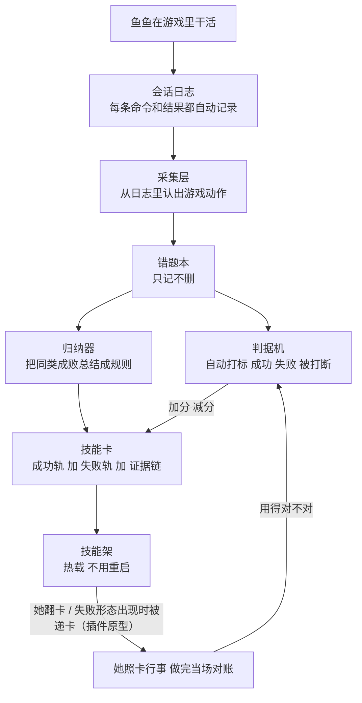

# feiyuos-experience-memory (expmem)

肥鱼 OS 游戏技能记忆：**行为过程 → 技能卡**。只补「过程」这一层——事实仍归
memory-hub / auto-memory / 手册§8 / shared-memory.md（知识层），两层用 evidence
互相点，不互相复述。

## 当前边界：Stardew-first（2026-11-12 评审明确）

现在真正跑通的经验链只有 **dsh 会话日志 → bash → sd 命令 → 星露谷动作** 这一条。
`adapters/tool_generic.py`、`adapters/minecraft.py`、`sources/live_tap.py` 尚未实现，
`api.record_action()` / `commit_episode()` 仍是 `NotImplementedError`——本仓
口径是「星露谷离线经验提炼 + 原生 Skill 卡消费」，不是「所有工具/游戏通用」。
通用化按 Action/Episode 协议走 **Adapter + Outcome Evaluator** 两个扩展点，
不为每个游戏另起一套技能记忆（见 docs/00-plan.md）。

## 行为语义（2026-11-12 下一批）

- **AppendOnly 跨进程幂等**：每次 append 在 `.lock` 独占锁内先吸收别家写入的行
  再判重；崩溃残行补换行终止、留档不删。POSIX=flock，Windows=msvcrt（测试机
  同样能跑并发用例）。
- **replay 版本闸**：out_dir/meta.json 记 parser_v/outcome_v，与代码版本不一致
  的重放直接拒绝——AppendOnly 改不了历史，两代行混一锅不是同一把尺。无 meta
  的旧目录放行（首次重放补写 meta，之后闸生效）。
- **执行/基准分离**：episode 带 `source`（默认 execution）；bench/fixture 来源
  的行不进归纳两轨（dropped 记 non_execution_source）。基准证据不许冒充她的
  执行经验。
- **pending_review 不进目录行**：矛盾/待二审的卡只进冲突对与 total_active
  （pending_hidden 计数）——注入未裁决的答案比不递更糟。candidate 照旧可召回
  （candidate→observed 的实验回路依赖被使用）。
- **冲突对不要求双边进目录**：注入侧的 contradicts 指着库里 active 的对手卡
  就标「同键两版未裁决」；deprecated 对手不算悬案。
- **settled 台账压实**：超 2000 行就地压（同 (session,turn) 留 max(v)，消费
  语义不变），旧文件留 .bak；压实只在 .settled.lock 内做。

## 她昨晚怎么用它（真实例子，2026-11-11 凌晨）

**1. 02:44 — 三张卡悄悄进了技能架。**
stardew-buy / stardew-store / stardew-probe-after-action 三张卡拷进她的技能目录，
技能架热加载，**不用重启她**。她下一个回合的技能清单里就出现了这三张卡。

**2. 03:01 — 她用了一次 skill 工具（2026-11-12 口径更正）。**
任务是「把鱼存进仓库」。她调了 skill 工具翻开 stardew-store 卡，照卡教的做：
连续三次探桥（间隔 30/60 秒重试），桥不通就如实说「存不了」，不硬编、不瞎猜。

> **11-12 口径更正**：当时我们把这次调用记作「她自己翻书」，事后全语料倒查证明
> 不是——那轮的用户消息（RN 团队信）里**点名了 `/store` 端点**。另一次
> stardew-fin-interface 调用同样是 RN 信点名了「鱼鳍 fin」。8537 次工具调用里
> skill 只被调 3 次，2 次有明确触发语的都来自外部点名，**0 次是看了目录按
> description 语义选中的**。见下节三层实测。

**3. 04:0x — 105 分钟的存箱攻坚，判据机判了「失败」。**
她跑了 20 多条命令：先拍库存照、扫箱子、五次尝试存箱，把所有失败方式都撞了一遍
（坐标写错→找不到箱子、物品名写中文→静默没存进去、返回 ok 但其实是空）。回合最后
被网络掐断没发出总结，但判据机从日志里**自动**判定这回合失败——不是她没干活，是活
没干成。第二天早上，她踩的两个坑（中文物品名假成功、返回 ok 不等于存进去了）已经
作为「失败轨」写进卡片 v2。**她用自己的失败教会了未来的自己**——这个回路就是本
模块存在的意义。

> 附一笔结案：「她包里的鱼一夜消失」不是 bug——是主人帮她清包了（2026-11-11 主人确认）。
> 跟物品名、桥、箱子都无关。卡里「name:"" 等于整包塞箱」的警示来自她 Stone x15 的
> 真实调用，与这件事无关，规则照留。

## 2026-11-12 凌晨：卡到底有没有被她看见（三层实测）

全语料（8537 次 tool/call、72288 行真会话）倒查出的三层，一层比一层根本：

**第一层：`retrieval_anchor` 是死字段。** dsh 的 parseSkillFile 只保留
name/description/whenToUse/metadata，其余 frontmatter 键在解析阶段丢弃；她的
72288 行会话里 `retrieval_anchor` 出现 **0 次**。我们过闸用的锚面和她的活面
（name+description）交集只有 2~31 词。⇒ 调 anchor 零收益，已改产卡规则：
description 场景在前、统计在后（commit 8037a11）。

**第二层：`isError` 是假信号。** bash 管道把退出码吃掉，工具层失败对她和我们都
不存在。按内容文本量才看得出：172 次 sd 端点调用里 7 次失败全是 `Traceback`，
其中 6 次集中 `/state`（19.4%）——根因是 `sd raw` 的 `[:1500]` 把 12387 字的
JSON 切成非法 JSON，**端点本身 0 失败**。已修（服务器 `bin/sd` 改折叠大字段，
`player`/`time`/`location` 永不折叠；诊断卡 `stardew-raw-truncated-json` 已入目录）。

**第三层：她从不查目录。** bash 调用 5222 次、覆盖卡片的 sd 端点调用 172 次、
skill 工具调用 3 次。目录全量注入才 2646 字 ≈ 1323 token——**成本不是问题，
时机才是**：她把 `sd /store` 敲进 bash 时，卡不在她视野里。没有查询，就没有召回。

⇒ 递卡插件原型 `plugin/expmem-card-delivery/`：照官方 dsh-repeat-tool-reminder
的注入合约（`tools/post-execute` → `additionalContexts`），只在已知失败形态
（`stored:[]` / 收菜 0 件 / sd raw 解析炸）出现时把卡递到她眼前，干净调用零打扰。
JS 侧在服务器 node v22 真跑全绿；**未部署**——注册进 `~/.dsh/cordis.patch.yml`
需重启 dsh-web，等主人拍板。

顺带发现并落了闸：`stardew-mine-fight` 卡曾是纯 markdown 无 frontmatter，在她
目录里**根本不存在**（静默不可见，无任何报错）。`skills.lint_catalog_visibility()`
挂在产卡路径上：frontmatter 合法 JSON / description 非空 / ≤500，三道闸对应
dsh 侧三个静默丢弃点。

## 模块架构（人话版）



| 层 | 一句话 |
|---|---|
| 会话日志 | 她干活的原始记录（dsh 会话事件流），这里只读不写 |
| 采集层 | 正则认出「她动了游戏」——锚点必须定期对活日志做命令形态普查（她改一次命令习惯就能让采集悄悄瞎掉一半，这事真发生过） |
| 错题本 | append-only 只记不删；被打断不算她的失败 |
| 判据机 | 机械判成败：有写动作 + 写完当场看到效果，缺一就判「不知道」，不许灌水 |
| 归纳器 | 从错题本总结成功轨/失败轨，自动长出技能卡 |
| 技能卡 | 原生 SKILL.md，每条规则都能点回她当天的真实调用（evidence 三元组） |
| 技能架 | dsh 技能目录热载，加卡不用重启 |
| 反馈闭环 | 用卡→有没有用→计数器加减→卡自动进化（已落码，等第一个真实回合闭环） |

## 目录

- `expmem/` 模块源码
- `skills/` 种子卡（retrieve 测试夹具——往这里加卡会改测试基线，生产卡别放这）
- `cards/` 生产卡镜像（她 live 技能目录的 documentary 副本，测试不消费；session 字段已掩码）
- `plugin/expmem-card-delivery/` 递卡插件（✅ 已部署并在她 web 面热载，2026-11-12，见 11-12 节）
- `tests/` 242 tests
- `docs/00-plan.md` 方案与验收口径（§7-13/§7-14 = 11-12 三层实测）

## 定位（防走样，cmb-absorb-research 2026-11-10 判据）

- 错题本 = 过程数据（tool, args, result, verdict），今天唯一存放点是本仓的
  `actions.jsonl` / `episodes.jsonl`——之前只躺在 dsh session 通用事件流里。
- 知识结论的正本不变：手册 §8（裁决）、shared-memory.md（台账）、INDEX.tsv（日期索引）。
- 技能卡 = 原生 `SKILL.md`（dsh-skill-filesystem 热监听，加文件不用重启）。

## S0（observe-only，零重启零插件）

```bash
python3 -m expmem.cli replay ~/.dsh/sessions/--home-agent-qq-workspace-- --out /tmp/expmem-out
```

只读重放，产出 `actions.jsonl` / `episodes.jsonl` / `metrics.json`。
验收口径与判据见 `docs/00-plan.md` §4（S0 行）。

## 测试

```bash
python3 -m unittest discover -s tests -t .
```

## 关键口径（别混）

- verb 级动作（段首锚定 + heredoc 截断）与 `sd raw <path>` 调用
  （不锚段首，吃 `$(sd raw …)`）是**两把尺子**，有重叠，分开计数。
- 归属闸：automation 会话计数照记，但**不进产物**。
- verdict 四值：success / failure / unknown / interrupted——外部打断不是她的失败，
  不进 bench 分母（cmb 对齐 C 条）。
- 隐私：真实 QQ 号不入公共仓——OWNER_PREFIXES 仓库默认假号 1000000001/2/3，
  部署侧放 `expmem/_owner_local.py`（gitignored）覆盖；文档与夹具里的会话名同用假号。
